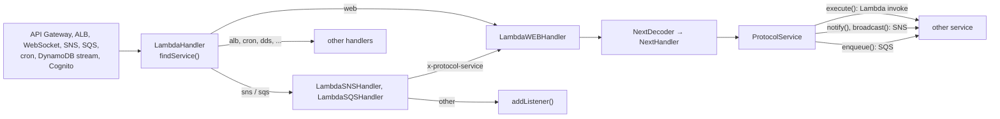

[](https://badge.fury.io/js/lemon-core)
[](https://badge.fury.io/gh/lemoncloud-io%2Flemon-core)

# lemon-core

Bootloader for serverless micro-services on AWS Lambda: one function, several event sources, an engine with modules, a protocol service.
This README is the entry point for people and AI agents; every path and command below is in this repo. `§` refers to `HOW_TO_UPGRADE_V5.md`.
v5 status: npm `latest` is `5.0.12` (2026-10-30; B18 coverage 96 % lines + `npm audit` 0, lemon-model `5.0.4` exact pin). The `v5` branch holds all 5.x work; `develop` is the default branch.
`CONTRIBUTING.md` § Branching describes both flows: `develop` for 4.x, `v5` for 5.x (merged into `v5` until it lands on `develop`).

## At a glance

| Item | Value |
|---|---|
| Runtime | Node `>=24.0.0` (`engines.node`), `.nvmrc` `24.15.0` |
| Build | TypeScript `^5.9.3`. `npm run build` = `build-ts` (`tsc`) + `scripts/gen-esm-wrapper.cjs` |
| Tests | vitest `^4.1.4`: `src/**/*.spec.ts`, `bin/**/*.spec.mjs` (`vitest.config.ts`) |
| Formats | CJS `dist/` + ESM `dist/esm/*.mjs`. `exports`: `.`, `./testing`, `./model` (5.0.9; shim folders for moduleResolution=node/Jest 27 unreleased), `./dist/environ`, `./dist/cores/lambda/lambda-web-handler`, `./dist/extended/cores`, `./dist/*` (until v6), `./package.json` |
| Dependencies | `@aws-sdk/client-dynamodb, @aws-sdk/lib-dynamodb, @opensearch-project/opensearch, @smithy/signature-v4, @types/aws-lambda, @types/jsonwebtoken, async, crypto-js, js-yaml, jsonwebtoken, lemon-model, mime-types, node-cache, qs, source-map-support` |
| Optional peers | 8 AWS SDK packages `^3.1159.0`, loaded on first use. `typescript` `>=4.7` (CLI) |
| Published | `files`: `dist/**/*`, the `bin/` CLIs and their `bin/lib/` modules (no specs or fixtures). Since B19 the Lambda tools `lemon-lambda-*`, `lemon-fields-admin`, `lemon-loop-check` ship too (`HOW_TO_UPGRADE_V5.md` § 19). CLI `lemon-fields-types` (since 5.0.5; see § 13.5) |
| Branches | `develop` is the default branch (its `version` is 4.3.0). `v5` holds the 5.x work. `master` was last updated in 2024 (3.2.9). |
| Version | The `version` field of `package.json`. |

## Repository map

| Path | What it holds | Who changes it |
|---|---|---|
| `src/index.ts` | Root barrel | Only through the `api:check` allow list |
| `src/engine/` | `$engine` singleton, `$U`, `_log`/`_inf`/`_err` | Rarely; every module and service depends on it |
| `src/cores/` | `lambda/`, `protocol/`, `config/`, `aws/`, `dynamo/`, `elastic/`, `storage/`, `cache/`, `api/` | Developer |
| `src/extended/` | `CoreService`, `ManagerProxy`; `cores/`: template layer (`MyCoreService`, `checkFieldsAdmin()`) | Developer |
| `src/controllers/`, `tools/`, `helpers/` | Controllers, `express`, `$T`, `$protocol()` | Developer |
| `src/lib/` | Internal: `safe-json`, `log-mask`, `qs-compat`, `http-fetch`, `lazy`, `perf`. `lib` barrel: `dynamodb-value` only | Developer. Internal; never re-exported from a barrel |
| `src/common/test-helper.ts`, `src/environ.ts`, `src/model.ts`, `model/`, `testing/` shim folders | Sub-paths `lemon-core/testing`, `lemon-core/dist/environ`, `lemon-core/model` (B16) | Rarely; all are published sub-paths |
| `bin/` | `lemon-fields-types` and the B19 Lambda tools (`lemon-lambda-*`, `lemon-fields-admin`, `lemon-loop-check`), `lib/` logic, specs, fixtures | Developer |
| `scripts/` | Build and API gates, lazy-load probes | Developer |
| `etc/api-names.v4.txt`, `etc/api-names.allow.txt` | v4 public-name baseline; allowed `+Name`/`-Name` | The baseline stays; add lines to the allow list only |
| `env/` | Configuration profiles | **Agents do not open it** |
| `docs/v5/`, `docs/specs/` | v5 design record (B0–B14); `$T`/`$U` specs | Updated with the change they describe |
| `dist/`, `coverage/` | Build and test output, ignored by git | **Never edited by hand** |
| `.github/workflows/` | None since B17 (`docgen.yaml` and the old CI config removed). No CI job; the gates run locally | A person |

## Request flow



- `LambdaModule` (`cores/lambda/`) runs `$engine.initialize()`, then `LambdaHandler.handle()`.
- Web: the type's controller (`addController()`) decodes to a `NextHandler` with a `NextContext`.
- SNS/SQS with `Subject` `x-protocol-service` pass a signature check, then `handleProtocol()`.
- `ProtocolService` (`core-services.ts`): `execute()` waits (unless `useEvent`); `notify()`, `enqueue()`, `broadcast()` do not.
- Failures resolve (Cognito rethrows); SQS/stream return `batchItemFailures` (§ 11.4).

## Usage

### 1. Install

```sh
npm install lemon-core --save
```

Add the AWS SDK peers you use to your own `dependencies` (§ 8.1).

### 2. Minimal bootstrap — engine initialization

```ts
// `$engine` is built at the first import, not lazily: set `process.env` before.
import $lemon, { $U, _inf } from 'lemon-core'; // default: { engine, cores, tools, controllers }
_inf('lemon-core loaded, NS=', $U.env('NS', 'TT'));
await $lemon.engine.initialize(); // resolves once every module's initModule() settles
```

ESM `import` gives the same instances (§ 2). Specs use `lemon-core/testing` (§ 4).
Since 5.0.9, lemon-model names that are not on the root come from `import { field, fieldsOf } from 'lemon-core/model';` — do not declare `lemon-model` yourself (§ 16).

### 3. Engine module registration — the "3-piece set"

```ts
// src/cores/protocol/index.ts (excerpt)
export class ProtocolModule implements EngineModule {
    public constructor(engine?: LemonEngine) {
        this.engine = engine || $engine;
        if (this.engine) this.engine.register(this); // (1) register; a same-name module is ignored
    }
    public getModuleName = () => 'protocol'; // (2) name
    public async initModule(level?: number): Promise<number> {
        const $conf = this.engine.module<ConfigModule>('config'); // (3) init level
        if (level === undefined) return $conf ? (await $conf.initModule()) + 1 : 1;
    }
    public readonly service: ProtocolService = new MyProtocolService();
}
export default new ProtocolModule(); // import-time instance, not lazy (`cores` group)
```

### 4. Manager / proxy registration — inter-service call example

```ts
import $lemon, { CallbackParam, ProtocolParam, ProtocolService } from 'lemon-core';

const service: ProtocolService = $lemon.cores.protocol.service;
const protocol: ProtocolParam = service.fromURL(context, 'api://lemon-hello-api/hello/echo', param, body);
const callback: CallbackParam = { type: 'hooks', id: `${id}` };
const queueId = await service.enqueue(protocol, callback, 30); // 30 seconds delayed
```

Controllers: `$lemon.cores.lambda.web.addController()`. Models: subclass `MyCoreService` (abstract `createProxy()`), `MyCoreManager`, `MyCoreProxy`. v5: `guardProxy()` saves on a throw only with `{ saveOnError: true }`; managers sync to OpenSearch only with `{ enableSync: true }` (§ 11.6).

## Commands

| Command | What it does | Note |
|---|---|---|
| `npm test` | `LS=1 vitest run` | Writes `coverage/`. |
| `npm run test:watch` | `LS=1 vitest` | Re-runs on file changes. |
| `npm run build` | `tsc` + ESM wrapper | Writes `dist/`. |
| `npx tsc --noEmit` | Type check only | Writes nothing. |
| `npm run lint` | `tsc --noEmit` + `eslint --fix` | **Rewrites files.** |
| `npm run format` | `prettier --write` on `src/` | **Rewrites files.** |
| `npm run api:names` | Root public names of `dist/index.d.ts` | Run `npm run build` first. |
| `npm run api:check` | Names vs `etc/api-names.v4.txt` + allow list | Run after `build`. Expect `not-allowed=0`; otherwise exit 1. |
| `npm run esm:smoke` | ESM and CJS entries are one instance | Run after `build`. Expect `esm-smoke: ok …`. |
| `npm run dup:check` | One declaring file per exported name | Expect `not-allowed=0`. |
| `npm run l1l2:probe` | Root/L1/L2 identity, deep paths (`dist/`) | Run after `build`. Expect `fails=0`. |
| `npm run fields:types` | `lemon-fields-types` here | Reports `models=0` in this repo. Consumers run `npx lemon-fields-types --root .`. |
| `npm audit --omit=dev` | Audit runtime dependencies | Expect `found 0 vulnerabilities`. |

## Verifying a change

Before saying a change is done, run:

```sh
npm test              # all test files pass, exit 0
npm run build         # exit 0
npx tsc --noEmit      # no output
npm run api:check     # api-check: … not-allowed=0
npm run esm:smoke     # esm-smoke: ok …
npm audit --omit=dev  # found 0 vulnerabilities
```

- `api:check`: no root name changes without an allow-list line.
- `esm:smoke`: the dual package keeps one `$engine`.
- `npm audit --omit=dev`: runtime dependencies stay at 0 (§ 14).
- Moved exports: also `dup:check`, `l1l2:probe`.

## Agent rules

- Public names change only via `api:check`: a `+Name`/`-Name` line in `etc/api-names.allow.txt`; the v4 baseline stays.
- `src/lib/*` is internal: never re-export it from `src/index.ts` or any barrel.
- No new runtime dependency unless `npm audit --omit=dev` stays 0 (§ 14).
- The 8 AWS SDK peers stay optional; SDK code loads on first use (§ 8).
- No `npm publish`, deploy or version bump: a person does those.
- 5.x work branches from `v5`.
- `lint` and `format` rewrite files: run them on purpose.
- Never open or print `env/*` or configuration values.
- When the docs and the source disagree, the source is right.
- New functions and blocks get a one-line comment (`src/lib/log-mask.ts`).

## Document index

| Document | Content |
|---|---|
| [HOW_TO_UPGRADE_V5.md](HOW_TO_UPGRADE_V5.md) | § 1 Node 24 · § 2 ESM · § 3 `exports` · § 4 testing · § 5 modules · § 6 deps · § 7 OpenSearch · § 8 AWS SDK · § 9 L1/L2 · § 10 `@field()` · § 11 trust · § 12 `src/cores/` · § 13 B10 · § 14 audit · § 15 channel/relay (B14) · § 16 `lemon-core/model` (B16) |
| [HOW_TO_UPGRADE_V4.md](HOW_TO_UPGRADE_V4.md) | v3 → v4 (historical) |
| [baseline.md](docs/v5/baseline.md) | B0-a baseline: link state, boot, run modes, test counts, public names |
| [B0-local-harness.md](docs/v5/B0-local-harness.md) | B0 local harness: the local run path as the verification gate |
| [B1-packaging.md](docs/v5/B1-packaging.md) | B1 packaging: dual entry, `exports`, single instance |
| [B2-inventory.md](docs/v5/B2-inventory.md) | B2 (dependencies and coupling): measured inventory |
| [B2-a-deps.md](docs/v5/B2-a-deps.md) | B2-a: dependencies out: `request`, `lodash`, `ioredis`, `memcached` |
| [B2-b-inventory.md](docs/v5/B2-b-inventory.md) | B2-b (search): measured inventory |
| [B2-b-search.md](docs/v5/B2-b-search.md) | B2-b search: OpenSearch client, ES names out, lazy `$OS2` |
| [B2-c-inventory.md](docs/v5/B2-c-inventory.md) | B2-c (AWS SDK soft coupling): measured inventory |
| [B2-c-aws.md](docs/v5/B2-c-aws.md) | B2-c AWS SDK: optional peers, lazy loading, local types, `PERF` lines |
| [B3-inventory.md](docs/v5/B3-inventory.md) | B3 (L1/L2 integration): measured inventory |
| [B3-l1-l2.md](docs/v5/B3-l1-l2.md) | B3 L1/L2 merge: one definition per name, removed aliases, renamed files |
| [B4-inventory.md](docs/v5/B4-inventory.md) | B4 (field annotations): measured inventory and experiments |
| [B4-field-annotation.md](docs/v5/B4-field-annotation.md) | B4: `@field()` in lemon-model, generated registry removed |
| [B5-inventory.md](docs/v5/B5-inventory.md) | B5 inventory: trust boundary and behaviour contract |
| [B5-trust-boundary.md](docs/v5/B5-trust-boundary.md) | B5: trust boundary and behaviour contract |
| [B6-dou-migration.md](docs/v5/B6-dou-migration.md) | B6: migrating a service that carries a `src/cores/` copy |
| [B7-perf-trace.md](docs/v5/B7-perf-trace.md) | B7: per-request `PERF` lines (`handle`, `request` + 4 steps) |
| [B8-kms-fetch.md](docs/v5/B8-kms-fetch.md) | B8: KMS `Decrypt` without the SDK (SigV4 + Node `https`) |
| [B10-context-source.md](docs/v5/B10-context-source.md) | B10: the first request path in `context.source` (Korean) |
| [B10-fields-types.md](docs/v5/B10-fields-types.md) | B10: field name/type consistency check `lemon-fields-types` (Korean) |
| [B10-header-log-mask.md](docs/v5/B10-header-log-mask.md) | B10: masking sensitive headers in logs (Korean) |
| [B10-report-account.md](docs/v5/B10-report-account.md) | B10: choosing the SNS account number in `doReportError()` (Korean) |
| [B10-report-circular.md](docs/v5/B10-report-circular.md) | B10: circular structures in error reports (Korean) |
| [B10-verify-enforce.md](docs/v5/B10-verify-enforce.md) | B10: runbook for switching to `PROTOCOL_VERIFY=enforce` (Korean) |
| [B11-deps-audit.md](docs/v5/B11-deps-audit.md) | B11: `npm audit --omit=dev` 0, `query-string` → `qs`, `uuid` removed (Korean) |
| [B13-access-policy.md](docs/v5/B13-access-policy.md) | B13: default data-access policy of `AbstractCRUDController` (`AccessPolicy`, `canDo` scopes) |
| [B14-relay-context.md](docs/v5/B14-relay-context.md) | B14 plan: `context.channel`, the signed relay `x-lemon-relay`, trace, `x-protocol-context` deprecation (Korean) |
| [B14-relay-context-impl.md](docs/v5/B14-relay-context-impl.md) | B14 implementation record (WP1–WP3): lemon-model `channel`/`trace`, `protocol-relay.ts`, entry changes (Korean) |
| [B15-security.md](docs/v5/B15-security.md) | B15: cross-cloud `cid`, list `view`, internal admin, policy keys `internal`/`cross` |
| [B16-model-subpath.md](docs/v5/B16-model-subpath.md) | B16: sub-path `lemon-core/model` (all of lemon-model), exact lemon-model pin, consumer rule |
| [B17-repo-hygiene.md](docs/v5/B17-repo-hygiene.md) | B17: the old CI config and the typedoc workflow removed (token rotation by the owner), `CONTRIBUTING.md` `v5` flow |
| [B18-audit-coverage.md](docs/v5/B18-audit-coverage.md) | B18: devDependencies audit 9 → 0 (vitest `4.1.12`, lemon-devkit `0.2.3`), coverage 70 % → 96 % lines (offline specs), six pinned behaviours to fix separately |
| [B19-bin-tools.md](docs/v5/B19-bin-tools.md) | B19: `lemon-lambda-invoke` / `-logs` / `-perf`, `lemon-fields-admin`, `lemon-loop-check` (from templates-api `bin/`) |
| [B19-bin-deploy.md](docs/v5/B19-bin-deploy.md) | B19: `lemon-lambda-pack` / `-local` / `-deploy` / `-deploy-dev` / `-migrate` (from templates-api `bin/`) |
| [docs/specs/](docs/specs/) | `$T`, `$U` characterization specs |
| [docs/header-identity-token.md](docs/header-identity-token.md) | Identity token header |
| [CONTRIBUTING](CONTRIBUTING.md), [SECURITY](SECURITY.md), [CODE_OF_CONDUCT](CODE_OF_CONDUCT.md) | PR process; supported versions; conduct |
| [CHANGELOG.md](CHANGELOG.md) | 5.0.5–5.0.12 entries (B10, B13, B14, B15, B16, B17, B18), then stops at 1.2.0 (2019); see VERSION INFO |

## Contribution

Plz, request PR.

See [CODE_OF_CONDUCT](CODE_OF_CONDUCT.md)

## LICENSE

[MIT](LICENSE) - (C) 2019 LemonCloud Co Ltd. - All Rights Reserved.

----------------

## VERSION INFO

| Version   | Description
|--         |--
| 5.0.12    | B18: tests 87 files / 1136 (lines 70 % → 96 %), vitest `4.1.12`, lemon-devkit `^0.2.3` (no `request`) — `npm audit` 0 (devDependencies only).
| 5.0.11    | B17: lemon-model `5.0.4` exact pin (TS2411 fix for strict consumers of `lemon-core/model`), repo hygiene (`.travis.yml`·typedoc workflow removed, CONTRIBUTING `v5` flow).
| 5.0.10    | B16-b resolution shims `model/`·`testing/` for `moduleResolution: node` and Jest 27 (§ 16).
| 5.0.9     | B16 sub-path `lemon-core/model` (`export * from 'lemon-model'`), lemon-model pinned exact `5.0.2` (D73).
| 5.0.8     | B15 security follow-up (§ 11.7, § 15.2); lemon-model `^5.0.2`.
| 5.0.7     | Re-publish of 5.0.6 (same source).
| 5.0.6     | B13 default data-access policy of `AbstractCRUDController` (§ 11.7); B14 `context.channel`, signed relay `x-lemon-relay`, `TRACE` line, `x-protocol-context` deprecated (§ 15); README rewritten as the v5 entry point; lemon-model `^5.0.1`.
| 5.0.5     | B10: `getHelloArn()` account (§ 13.1), circular-safe reports (§ 13.2), masked header logs (§ 13.3), enforce runbook + masked config log (§ 13.4), `lemon-fields-types` (§ 13.5); `LOCAL_TRANSPORT=mock` opt-in (§ 11.3.1).
| 5.0.4     | `context.source` carries the first request path; `npm audit --omit=dev` 0 (`qs`, `randomUUID()`, AWS SDK `^3.1159.0`).
| 5.0.3     | KMS `Decrypt` via SigV4 + Node `https`, without `@aws-sdk/client-kms` on the boot path.
| 5.0.2     | per-request `PERF` lines (`request`, `handle`).
| 5.0.1     | `GET /<type>/fields/admin` + `checkFieldsAdmin()`; env `DEFAULT_TIME_ZONE`, `DATE_ONLY_CLOCK`, `SID_LEGACY_ACCESS`.
| 5.0.0     | Node 24, ESM entry + `exports`, AWS SDK optional peers, OpenSearch client, `@field()`, signed protocol calls.
| 4.3.0     | embed cores template layer as extended/cores
| 4.2.6     | optimized `$protocol.execute()` to support async lambda invocation.
| 4.2.5     | optimized `isBase64Encoded` to support apigwBinary. (from `4.1.17`)
| 4.2.4     | optimized `doReportError` to ignore in local dev. (from `4.1.16`)
| 4.2.3     | optimized `ManagerProxy.inc()` w/ `string[]` parameters.
| 4.2.2     | optimized `StorageService.increment()` w/ `string[]` parameters.
| 4.2.1     | optimized `storage-service` w/ `dummy` service (+ audit fix).
| 4.2.0     | optimized `node@24.15.0` w/o `ttypescript` + `jest`.
| 4.1.12    | optimized `synchronizer` w/o `elastic` config.
| 4.1.12    | optimized `@aws-sdk` w/ version `3.971.0`.
| 4.1.11    | optimized `proxy.mget` w/ `error-reporting` option.
| 4.1.9     | optimized `proxy.mget` w/ `getaddrinfo` error.
| 4.1.5     | optimized `saveAllUpdates` w/ failed model as cause.
| 4.1.2     | optimized `asErrorPayload` w/ env[`MY_PARALLEL_THROW`].
| 4.1.0     | optimized `DynamoService.mreadItem()` along with `lemon-model@1.1.1`
| 4.0.8     | optimized `findKMSService()` w/ shared pool storage.
| 4.0.7     | optimized `verifyJWT()` w/ more detail error.
| 4.0.6     | optimized `loadProfile()` as sync call.
| 4.0.5     | improve `$protocol` w/ `lambda` invoke.
| 4.0.0     | optimized with `nodejs22`.
| 3.2.16    | improve `ALBHandler` to support `elb` event.
| 3.2.15    | improve `NextContext` to support `referer` and `origin` header.
| 3.2.13    | improve `createSigV4Proxy()` to support the sig-v4 request to AWS.
| 3.2.12    | improve `buildResponse()` to determin content-type of html.
| 3.2.11    | updated `elastic6-service` to support `SearchProxy`.
| 3.2.10    | updated `elastic6-service` to fix `400 ILLEGAL ARGUMENT` (script parsing).
| 3.2.9     | improve `elastic6-service` w/ latest open-search.
| 3.2.8     | updated `ttypescript^1.5.15`, and optimized.
| 3.2.7     | cleanup log message in `AWSS3Service`, and optimized.
| 3.2.6     | improve `listObjects()` in `AWSS3Service` w/ prefix.
| 3.2.5     | improve `doReportError` in `lambda-web-handler`.
| 3.2.4     | updated with `lemon-model@1.0.2`.
| 3.2.3     | support `ES7.10`, and improve sync to elastic.
| 3.2.1     | improve `getIdentityId()` w/ `env:LOCAL_ACCOUNT`.
| 3.2.0     | upgrade all packages, and clear `audit fix`.
| 3.1.2     | refactoring with `lemon-model@1.0.0` for shared types.
| 3.1.1     | support `ManagerProxy`, `AbstractProxy` and `$ES6`. (`x-lemon-identity` as WebToken)
| 3.1.0     | upgrade `typescript^4.6.2`, and optimized.
| 3.0.2     | support `helpers` like `$T`.
| 3.0.0     | improve search-client with `@elastic/elasticsearch@7.12` to support AWS `OpenSearch 1.1` (compartible with `ES6.2`).
| 2.2.20    | improve an extra feature from `aws-s3-service` to 'lemon-images-api'
| 2.2.19    | improve search filtering feature for `ES6 autocomplete search`.
| 2.2.18    | support `$U.jwt(passcode).encode(...)` w/ `npm`.
| 2.2.16    | hot-fix `utf8 encoding of json` in `AWS.S3`.
| 2.2.15    | hot-fix `Cannot read property 'setIndex' of null` in `Dynamo`.
| 2.2.14    | support `CacheService`, and support appending entry into list in `Dynamo`.
| 2.2.13    | improve `LambdaWEBHandler` to support custom web-response including headers.
| 2.2.12    | improve `AWSS3Service` to use pure JS image library because of AWS compatibility issue.
| 2.2.11    | improve `AWSS3Service` by adding handy method and metadata+tag handling
| 2.2.10    | improve `Access-Control-Allow-Origin` w/ `Access-Control-Allow-Credentials: true`.
| 2.2.9     | support `content-type:application/x-www-form-urlencoded` form data.
| 2.2.6     | improve `search`, and support `cookie` in NextContext.
| 2.2.5     | support `Access-Control-Allow-Headers` for CORS.
| 2.2.3     | support `x-lemon-language` header in identity.
| 2.2.0     | support `AbstractManager` for the template of model managers.
| 2.1.17    | support `filter()` in DynamoStream.
| 2.1.16    | improve `lock()` w/ 404 error, and `.aggregations` in QueryResult.
| 2.1.14    | support `hash` param for `MocksAPIService`.
| 2.1.13    | support `HttpStorage`, `$U.crypto2`, and `/favicon.ico`.
| 2.1.12    | support `userAgent` in NextContext.
| 2.1.11    | improve `syncToElastic6`, and `DynamoScanService`.
| 2.1.10    | support `loadProfile()`, and lookup-id style.
| 2.1.8     | improve `express` of request-context.
| 2.1.7     | improve `TypedStorageService` w/ `save()`.
| 2.1.5     | support `GeneralAPIController` along w/ `UniqueFieldManager`.
| 2.1.3     | support `asNextIdentityAccess()` for access identity.
| 2.1.2     | support `ProxyStorageService` for shared common storage.
| 2.1.1     | support `enqueue()` with delayed-seconds.
| 2.1.0     | support `ProtocolService` for inter communication of micro-services.
| 2.0.10    | support to display the current name/version by `GET /`.
| 2.0.9     | improve `Elastic6Service` + `Elastic6QueryService`.
| 2.0.8     | improve `APIService` w/ mocks data.
| 2.0.7     | improve `StorageService` along w/ dummy-storage-service.
| 2.0.6     | support `CoreWEBController`, and `lambda.cores.web.addController(...)`
| 2.0.5     | support `APIService`, and fix `engine.initialize()`
| 2.0.3     | support `StorageService` along with `DynamoStorageService`
| 2.0.0     | improve `lemon-engine`, and support `typescript` fully.
| 1.2.15    | improve `doReportError` with error message
| 1.2.12    | support `doReportMetric()` for saving metric data.
