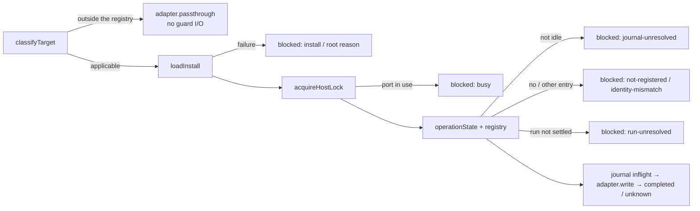

# v5 B30 — migration guard: one write at a time per installation (`bin/lib/migrate-guard.mjs`)

Track: v5 deployment (in preparation, `HOW_TO_DEPLOY_V5.md`), not the code upgrade (`HOW_TO_UPGRADE_V5.md`).

Status: implemented on `feat/v5-b30-migration-guard` (base `v5` @ `4726bfd9`, lemon-core 5.0.19). Not released; no
version bump. This is P2-a of the deployment-migration tool plan: the common execution base. It is a **library
only**: no deploy or migrate writer calls it yet, and no CLI command or flag was added. Connecting the writers
(`lemon-lambda-migrate`, `lemon-lambda-deploy`, `lemon-lambda-deploy-dev`) is left to the next per-service changes.

## Why

The deploy and migration tools of a reviewed target can run from several sessions and several checkouts on one
machine at the same time. Each checkout has its own run state, so nothing stopped two of them from writing to the
same target together, or a second one from starting while the first ended in an unknown state.

B30 adds one shared base for that:

-   only one guarded write at a time per installation (a loopback port as the host lock);
-   one journal per installation that remembers an unfinished or unknown write until an owner decision is recorded;
-   one registry of the reviewed targets that this installation looks after (expected account and region).

The guard applies only to the reviewed registry `ORG_DEFAULTS.migration.targets` (three entries today). A general
deploy target keeps its path and its results unchanged, and the guard does **no** state I/O for it (N14): no install
file, no root, no port, no journal is read or opened.



### Commands and the guard

| Command                                                                               | Guard             | Why                                             |
| ------------------------------------------------------------------------------------- | ----------------- | ----------------------------------------------- |
| `lemon-lambda-deploy` (apply)                                                         | planned (next PR) | writes the target; **not connected in this PR** |
| `lemon-lambda-deploy-dev` (apply)                                                     | planned (next PR) | writes the target; **not connected in this PR** |
| `lemon-lambda-migrate` six phases with `--execute`                                    | planned (next PR) | writes the target; **not connected in this PR** |
| `lemon-lambda-migrate inspect \| reconcile \| resolve \| adopt-baseline`              | outside           | read-only, or a local attestation               |
| `lemon-lambda-pack`                                                                   | outside           | local artifact                                  |
| `lemon-lambda-env build \| diff`                                                      | outside           | local artifact / read-only                      |
| `lemon-lambda-local`, `lemon-lambda-invoke`, `lemon-lambda-logs`, `lemon-lambda-perf` | outside           | local run, app calls or reads, no deploy write  |

"Planned" means the command calls `guardedWrite` only after its per-service PR; in B30 every command above behaves
exactly as before. The writer PR passes the values that passed the `deploy-plan` validation to `classifyTarget`
(never raw input).

## API

All functions are exported from `bin/lib/migrate-guard.mjs`. Errors are `MigrationError(code, message)` with a short
English message and no value (no account, no root path, no secret). Every function takes optional `deps`
(`fs`, `net`, `now`, `homedir`, `targets`) for tests.

| Function                                                                | What it does                                                                                                                                                                                                                                          |
| ----------------------------------------------------------------------- | ----------------------------------------------------------------------------------------------------------------------------------------------------------------------------------------------------------------------------------------------------- |
| `classifyTarget({ project, stage, stack? })`                            | Exact string match on project + stage (no trim, no case folding). None → `not-applicable` (`outside-registry`); one → `applicable` with `identity` (a given `stack` must equal the entry's, else `TARGET_MISMATCH`; a missing one takes the entry's). |
| `loadInstall({ env })`                                                  | Reads the install file and checks its root (§ State files). Returns `{ root, port, machineId, localVolume }` (frozen).                                                                                                                                |
| `initializeRoot(install)`                                               | Creates a new root once, at installation (§ State files). An existing root is `ROOT_EXISTS`.                                                                                                                                                          |
| `acquireHostLock({ port, holder })`                                     | Exclusive listen on `127.0.0.1:<port>`. Returns `{ port, holder, acquiredAt, release() }`; a port in use is `LOCK_BUSY`.                                                                                                                              |
| `readRegistry(install)` / `registerTarget(install, entry)`              | Reads / adds or updates a registry entry (under the host lock; an overwritten entry moves to `history[]`).                                                                                                                                            |
| `operationState(install)`                                               | `'idle' \| 'inflight' \| 'unknown'` from the journal.                                                                                                                                                                                                 |
| `resolveOperation(install, operationId, { decision: { ref, digest } })` | Adds `resolution: { decision: { ref, digest }, at }` to an `inflight` / `unknown` journal file (under the host lock).                                                                                                                                 |
| `guardedWrite({ input, expected, env, adapter, holder, signal })`       | The ordered write (below). The install file comes from `installPath` (§ Install file).                                                                                                                                                                |
| `guardStatus(input, expected, { env })`                                 | The read-only status for a `plan`: classification, installation, journal and registry without the lock and without writes.                                                                                                                            |
| `installPath({ env })`                                                  | `LEMON_MIGRATION_GUARD_INSTALL` (absolute only) or `~/.lemon-core/migration-guard.install.json`.                                                                                                                                                      |
| `runStateRefOf(path)` / `unsupportedVolume(root)` / `scrub(text)`       | Helpers: sha256 of a private absolute run-state path (a relative one is `INVALID_INPUT`); the sync / mount path check; the free-text filter.                                                                                                          |

### `guardedWrite`

1. `classifyTarget(input)`. Outside the registry it returns at once
   `{ applicability: 'not-applicable', reason: 'outside-registry', adapterResult: await adapter.passthrough?.() }`.
2. `loadInstall`. A failure returns `{ applicability: 'applicable', status: 'blocked', reason, identity }` with
   `reason` = the code in lower case: `install-invalid`, `root-invalid`, `root-missing`, `root-mismatch`,
   `root-unsupported-volume`. The adapter is not called.
3. `acquireHostLock`. `LOCK_BUSY` → `blocked: 'busy'`. No other port is tried.
4. Under the lock, `operationState`. Not `idle` → `blocked: 'journal-unresolved'`. No write, no retry, no repair.
5. The registry entry of `<account>/<region>/<stage>/<project>` (`expected` = `{ account, region }` from the private
   config). None → `blocked: 'not-registered'`; the target registered under another account / region, or an entry
   whose stack differs → `blocked: 'identity-mismatch'` (the expected values of the private config compared with the
   registry; the comparison with the live STS account belongs to the writer PR). An unsettled run state →
   `blocked: 'run-unresolved'` (§ Registry entry). The `ready` status of `guardStatus` means: installation valid,
   journal idle, entry found with the same identity, and a settled run state.
6. A journal file `inflight` (fsync), then `adapter.write({ identity, operationId, signal })`. A result
   `{ requestIds?, receiptDigest?, before?, after? }` (ids `[A-Za-z0-9._:-]{1,128}`, digests sha256 hex) makes it
   `completed` (same file, replaced atomically). A throw or an invalid result makes it `unknown` (error code and a
   scrubbed message of at most 200 characters), and `WRITE_UNKNOWN` is thrown (`unknown: true`, `operationId`) —
   without the adapter's own message, which may hold a secret. When the journal itself cannot be written after the
   adapter call (`completed` or `unknown`), `WRITE_UNKNOWN` also carries `stateWriteFailed: true` and the file may stay
   `inflight` (still blocking).
7. Returns `{ applicability: 'applicable', status: 'completed', operationId, identity }`. The lock is released in
   every case.

`classifyTarget` errors (`INVALID_INPUT`, `TARGET_MISMATCH`, `REGISTRY_INVALID`) are thrown, not `blocked`.

## State files

### Install file (outside the root)

The install file is found by `installPath`: `LEMON_MIGRATION_GUARD_INSTALL` when set (an absolute path; a relative
one is `INSTALL_INVALID`), else the default fixed path `~/.lemon-core/migration-guard.install.json`. No function takes
an install path or a root as an argument. Mode 0600 recommended.

```json
{
    "schemaVersion": 1,
    "root": "<absolute path>",
    "port": 47210,
    "machineId": "<1..64 of [A-Za-z0-9._-]>",
    "localVolume": { "confirmedBy": "<1..200 characters>", "at": "<ISO 8601>" }
}
```

-   Any other key or type → `INSTALL_INVALID`; so is a missing or unreadable file, a port that is not an integer in
    1024..65535 (port `0`, an automatic port, is refused), and an install file inside the root.
-   The root must be absolute, normalized and its own real path: a symlink (the root or a parent) or a relative path
    → `ROOT_INVALID`. It must exist as a directory with an `install.json` (`ROOT_MISSING`).
-   The root `install.json` must hold the same `schemaVersion`, `root`, `port` and `machineId` (`ROOT_MISMATCH`): a
    copied root or the root of another installation is refused.
-   `MIGRATION_STATE_DIR`, when set, must equal the root (`ROOT_MISMATCH`).
-   The root and the port have one source, the install file; its place is the default fixed path or an absolute path
    the operator sets in the env. Making a second installation through the env is an operator act that the guard
    does not stop (§ Limits).
-   Sync / mount check (best effort, case-insensitive): a path segment `Dropbox`, `iCloud`, `Mobile Documents`,
    `Google Drive`, `GoogleDrive`, `OneDrive`, `Box`, `Nextcloud`, `Sync` or `CloudStorage` (also followed by a
    non-alphanumeric suffix such as `Dropbox (Personal)`), or a path under `/Volumes/`, `/mnt/` or `/net/` →
    `ROOT_UNSUPPORTED_VOLUME`. A path check cannot detect every sync app: for example `~/Documents` and `~/Desktop`
    are synced when iCloud "Desktop & Documents" is on, and their path shows nothing. That is why
    `localVolume.confirmedBy` must record who confirmed that the root is on a local, non-synced volume.

### Root (`initializeRoot`)

| Entry           | Mode | Contents                                                                                      |
| --------------- | ---- | --------------------------------------------------------------------------------------------- |
| `install.json`  | 0600 | `{ schemaVersion: 1, root, port, machineId, initializedAt }` (written last)                   |
| `registry.json` | 0600 | `{ schemaVersion: 1, machineId, entries: { "<account>/<region>/<stage>/<project>": entry } }` |
| `journal/`      | 0700 | one file per write: `<UTC stamp>-<operationId>.json`                                          |

-   The parent of the root must exist and be its own real path; `mkdir` without `recursive` is the exclusive step.
-   Every write is atomic: temp file (`wx`, 0600) → fsync → rename → directory fsync. Every fs failure is a
    `MigrationError` (`STATE_WRITE_FAILED`, or `ROOT_INVALID` for the root itself) with a fixed message, never a raw
    fs error with a path.

### Registry entry

`{ identity: { project, stage, stack }, account, region, runStateRef, class, runState, baselineKind, registeredAt, history? }`. `account` is 12 digits, `region` matches `^[a-z]{2}-[a-z]+-\d$`; both are the expected values of the
private config, never a profile name. `runStateRef` is a sha256 digest of the private run-state path
(`runStateRefOf`), never the path. Only reviewed targets are registered (`TARGET_MISMATCH`). **A registration is
neither a write approval nor a migration success**, and it never changes whether a target is applicable: an
applicable target without an entry is `blocked: 'not-registered'`. `registerTarget` is allowed while the journal is
unresolved: it is a control record, not a write of the target.

The run-state fields are enums (anything else is `INVALID_INPUT`):

| Field          | Values                                                      |
| -------------- | ----------------------------------------------------------- |
| `runState`     | `completed`, `resolved-observed-diff`, `unresolved`, `none` |
| `class`        | `verified-no-op`, `reconcile-required`, `blocked`           |
| `baselineKind` | `run-receipt`, `first-observation`, `reviewed-rebaseline`   |

A guarded write is `blocked: 'run-unresolved'` when `runState` is `unresolved`, when `class` is `blocked` or
`reconcile-required`, or when `runState` is `none` with a `baselineKind` other than `first-observation`.

The registry is chosen per installation and by the expected identity: several entries of one project / stage under
other account / region keys are allowed, and the expected key selects one. This is not the ambiguity of the target
list (which is `REGISTRY_INVALID`).

### Journal file

`{ schemaVersion: 1, operationId, identity, holder, startedAt, state, requestIds, before?, after?, receiptDigest?, endedAt?, error?, resolution? }`, `state` one of `inflight`, `completed`, `unknown`.

`operationState`:

-   any damaged entry (not parseable, another schema, not a regular file, a name without its operation id) →
    `unknown`;
-   else the newest `inflight` / `unknown` file without a `resolution` gives the state; `completed` files and files
    with a `resolution` count as idle; no file → `idle`;
-   no `journal/` → `unknown` (a normal initial state cannot be shown; the journal is never created on demand). A
    temp file of an interrupted atomic write is not a record.

`resolveOperation` needs a `decision: { ref, digest }`. `ref` (1..200 of `[A-Za-z0-9._:/#@?=&%+~-]`, for example a
review comment URL `https://github.com/o/r/pull/1#issuecomment-99` or `D94@8f6396aa`) points to the owner decision
and is stored **byte for byte** (no scrub). So a ref that holds a 12-digit number, a dashed account id, an access key
id, `arn:aws` (also URL-encoded `arn%3Aaws`), a secret-like word (`secret`, `token`, `password`, …), a blank or a
control character is refused (`INVALID_INPUT`), never stored. `digest` is the sha256 hex of the decision text that
the caller keeps. A reason text alone does not resolve. It adds `resolution` and keeps every original field.

A file outside the name rule in `journal/` (for example `.DS_Store`) makes the state `unknown`, and
`resolveOperation` cannot clear it (fail-closed). The operator checks the file, removes it, then retries.

## Checks

-   N14: outside the registry, `guardedWrite` / `guardStatus` touch neither `fs` nor `net` (tested with spies that
    record every access).
-   A damaged target list (not frozen, an entry without a string project / stage / stack / revision, a project +
    stage twice) is `REGISTRY_INVALID` for every input — never "outside the registry" (fail-closed).
-   The lock is a TCP listen on `127.0.0.1` only, taken after `listening`; incoming connections are closed at once
    and get no data. The process keeps running while it holds the lock (no `unref`). The OS frees the port when the
    process ends, also after `SIGKILL` (tested: the port is taken again within 2 s). Lock released ≠ work completed:
    the journal decides the latter.
-   Free text (holder, adapter error message and code) is stored through `scrub()`: control characters dropped,
    URL-encoded ARNs (`arn%3Aaws…`) and dashed account ids (`dddd-dddd-dddd`) masked, `redact()` of `common.mjs`
    (account ids, ARNs, access keys, keyed secrets, bearer / JWT tokens, IPs, URLs, emails), every word holding a
    secret-like fragment (`secret`, `token`, `password`, …) hidden, cut to 200 characters. The decision ref is not
    scrubbed: it is refused when it looks like a secret (§ Journal file).
-   A journal file outside the name rule (`.DS_Store`, …) is `unknown` until the operator removes it.
-   Outputs (return values, messages) carry the identity, the status, the reason, the operation id and the scrubbed
    holder only: no account, no root path.

## Limits

-   A cooperative procedural control between the tools of one installation; **not a security boundary**. A tool that
    does not use the guard, another installation (another install file and port) or another machine is not stopped.
-   The port must be reserved for the guard. On some systems a listener on the wildcard address does not conflict
    with a `127.0.0.1` bind; only guard instances (all binding `127.0.0.1`) are sure to exclude each other.
-   Another install file set through `LEMON_MIGRATION_GUARD_INSTALL` (another root and port) is a second installation;
    that is an operator act, and the guard does not stop it.
-   The sync / mount check is a path check only (best effort); the install file's `localVolume.confirmedBy` is the
    record of the human check.
-   `scrub()` masks known forms only: a bare 40-character secret key without a key name, a session token or an
    absolute path can pass. The journal lives inside the root (0700).
-   fsync is the OS default (not `F_FULLFSYNC` on macOS); durability across a power cut is not verified.
-   `resolveOperation` records that a decision exists; it does not check the target, approve a write or prove the
    result of the unknown operation.
-   `guardStatus` reads without the lock: its answer can change before a later `guardedWrite`, which checks again
    under the lock.
-   Not yet connected: no writer calls the guard in B30, no AWS read is made, the registry is filled by callers.

## Tests

`bin/lib/migrate-guard.spec.mjs` (19), temp dirs under `os.tmpdir()`, free loopback ports only, fake adapters:
V12-1 outside the registry (passthrough once, `fs` / `net` untouched, nothing created); V12-2 root missing (adapter
not called, nothing created); V12-3 deleted registration, another cwd, stack rule, exact match, identity mismatch by
account and by stack; V12-4 an unknown journal of A blocks B, C outside stays `not-applicable`; V12-5 two concurrent
locks (one `LOCK_BUSY`, free after release, no data on a connection); V12-6 a child holding the lock is `SIGKILL`ed
and the parent takes the port within 2 s; V12-7 / 7b adapter throw after `inflight` → `unknown`, blocked,
decision rules, append-only resolution, then a completed write; a left-over `inflight` file and a damaged file;
V12-8 state-dir env, root `install.json` port, port 0 / 80 / 1023, symlinked and relative root, sync and mount paths,
install file inside the root; V12-9 no `journal/` and no `initializedAt` → `unknown`, `initializeRoot` once, then
`ROOT_EXISTS`; V12-10 `REGISTRY_INVALID` (fail-closed for inputs outside too); V12-11 `guardStatus` while the port is
held elsewhere (no lock taken; the write is `busy`); V13-12 canary strings (`AKIA…`, `arn:aws:…`, a 12-digit number,
`SECRET_CANARY_…`, a URL-encoded ARN, a dashed account id) in the holder, decision refs, adapter error, install note
and refused inputs never reach a state file, a thrown message or a returned object. Review round 2: R2-M1 decision
refs stored byte for byte, digest required, secret-like refs refused and not stored; R2-S1 a journal write failing
after the adapter (success and throw) → `WRITE_UNKNOWN` + `stateWriteFailed`, file stays `inflight` when the rename itself failed (after a successful rename only the directory fsync is unproven); R2-S2 injected
`open` / directory `open` / `chmod` / `mkdir` failures are `MigrationError`s without a path; R2-S3 run-state enums and
`run-unresolved`; R2-S4 relative env path, default home path, missing default; R2-S6 two concurrent
`resolveOperation` (one `LOCK_BUSY`) and `resolveOperation` / `registerTarget` during a write (`LOCK_BUSY`).
