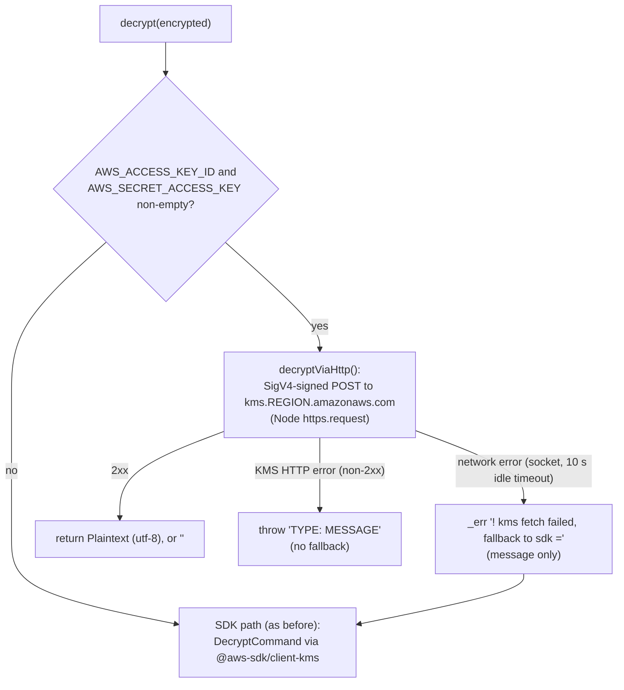

# v5 B8 — KMS `Decrypt` without the SDK (SigV4 + Node `https`)

Status: implemented 2026-10-29 on `feat/v5-b8-kms-fetch` (base `v5` @ `09baf6b3`). Decision D55 (Q13 = (b) SigV4 + `fetch`). Builds on the D40 `PERF` lines (`HOW_TO_UPGRADE_V5.md` § 8.5) and the B7 measurements (`docs/v5/B7-perf-trace.md`).

## Why

`ConfigService.init()` calls `AWSKMSService.decrypt()` at boot for every env value that starts with `*`. The first call lazy-loads `@aws-sdk/client-kms`. On a dev Lambda cold start (about 1.5 s) that load was about 694 ms of `initialize`. About 70 % of it is the shared `@aws-sdk/core` / `@smithy/*` stack, so a smaller SDK client does not help. The SigV4 signer alone loads in a few ms. B8 replaces **only the decrypt path** with one signed HTTPS call to the KMS JSON API when the env has credentials (the Lambda case). The transport is Node `https.request`, not `fetch`: the first `fetch` call of a process loads undici, which the dev Lambda paid as ~250 ms inside the decrypt (see Gates).

## Scope

- **New internal module** `src/cores/aws/kms-fetch.ts`. Not exported by `src/cores/aws/index.ts` or any other barrel. It exports, for the service and its spec only: `hasEnvCredentials()`, `decryptViaHttp()`, `isKmsHttpError()`, `NodeSha256`, `transportOf()` / `httpsTransport`.
- **`AWSKMSService.decrypt()`** selects the path (below). `encrypt()`, `sign()`, `verify()` and `getPublicKey()` use the SDK as before.
- **New direct dependency** `@smithy/signature-v4` `^5.3.8`. It was already installed (transitive via `@aws-sdk/core`), so the lock gains no package and no version change (one line in the root entry).
- **No public name change.** `npm run api:names` is identical to the base (299 names). No `@smithy` or `@aws-sdk` type in `dist/**/*.d.ts`.

## Path selection



- The region is the same as the SDK path: `$engine.environ('REGION', 'ap-northeast-2')`.
- The fallback runs once per call. The log line has the error message only (no credentials, no headers, no body).
- A KMS HTTP error propagates. `ConfigService` turns it into an `ERROR - …` value as before (the message format is the same family as the SDK error: `<type>: <message>`).
- Without env credentials (a local `AWS_PROFILE`, an instance role through the SDK chain, …) nothing changes: the SDK path runs.

## Request

```
POST https://kms.<region>.amazonaws.com/
content-type: application/x-amz-json-1.1
x-amz-target: TrentService.Decrypt
host: kms.<region>.amazonaws.com
x-amz-date: <YYYYMMDDTHHMMSSZ>               (added by the signer)
x-amz-content-sha256: <hex>                   (added by the signer)
x-amz-security-token: <AWS_SESSION_TOKEN>     (added by the signer, only when the env has one)
authorization: AWS4-HMAC-SHA256 Credential=<key>/<yyyymmdd>/<region>/kms/aws4_request, SignedHeaders=..., Signature=<64 hex>

{"CiphertextBlob":"<the input base64>"}
```

- No `KeyId`: KMS reads the key from the ciphertext blob (the SDK path does not send one either).
- The signer is `SignatureV4({ service: 'kms', region, credentials, sha256: NodeSha256 })`. The credentials come from `AWS_ACCESS_KEY_ID`, `AWS_SECRET_ACCESS_KEY` and the optional `AWS_SESSION_TOKEN`, which Lambda sets for the execution role.
- `NodeSha256` wraps Node `crypto` (`createHash('sha256')`, or `createHmac('sha256', secret)` with a secret). No `@aws-crypto/sha256-js`.
- The same body string is signed and sent.
- The signer input is a local structural type (`method`, `protocol`, `hostname`, `path`, `headers`, `body`); no `HttpRequest` type import.
- The transport is `httpsTransport` = `transportOf(https.request)`: whole body read, `ok` = 2xx, socket error or the 10 s idle timeout rejects (a network error → SDK fallback). `AWSKMSService` has a protected `_transport` for tests; `globalThis.fetch` is a compatible transport but is not the default.

## Response

| Response | Result |
| --- | --- |
| 2xx with `Plaintext` | `Buffer.from(Plaintext, 'base64').toString('utf-8')` |
| 2xx without `Plaintext` | `''` (same as the SDK path) |
| non-2xx, body `{ __type, message }` | `Error('<type>: <message>')` with `kmsError = true`. `__type` like `com.amazonaws.kms#InvalidCiphertextException` keeps the part after `#` |
| the transport rejects (DNS, `ECONNREFUSED`, idle timeout, …) | the rejection as is (`isKmsHttpError(e)` is `false`) |

## Logs

The signer package is required on the first decrypt and prints one D40 line through `_inf`; every SDK-less decrypt then prints one line with the split `sign=` (SigV4), `send=` (connect + request + whole response) and `decode=` (base64):

```
2026-10-29 10:00:00 I PERF: > lazy-load @smithy/signature-v4 3.4 ms
2026-10-29 10:00:00 I PERF: > kms decrypt 212.0 ms sign=1.2 send=210.5 decode=0.3
```

On the fetch path there is no `lazy-load @aws-sdk/client-kms` line and no `client KMS` line at boot. They show again only when a later `encrypt`/`sign`/`verify`/`getPublicKey` call, or the network fallback, uses the SDK. `LS=1` silences the lines like every other line.

## Files

| File | Change |
| --- | --- |
| `src/cores/aws/kms-fetch.ts` | new (internal): `hasEnvCredentials`, `decryptViaHttp`, `isKmsHttpError`, `NodeSha256`, `transportOf`/`httpsTransport`, lazy signer loader |
| `src/cores/aws/kms-fetch.spec.ts` | new: 13 offline tests (credentials check, request shape, session token, decode, KMS error, network error, 4 routing cases in `AWSKMSService.decrypt()`, 3 transport cases on a fake `request()`) |
| `src/cores/aws/aws-kms-service.ts` | `decrypt()` selects the SDK-less path (protected `_transport` for tests); network-error fallback to the SDK |
| `package.json`, `package-lock.json` | `@smithy/signature-v4` `^5.3.8` in `dependencies` (lock: root entry only) |
| `HOW_TO_UPGRADE_V5.md` | § 8.7 |
| `docs/v5/B8-kms-fetch.md` (this file) | new |

## Gates (2026-10-29, local)

| Gate | Base `v5` @ `09baf6b3` | B8 |
| --- | --- | --- |
| `npm test` (`LS=1`, 2 runs) | 54 files, 569 passed | 55 files, 579 passed (+10 `kms-fetch`), 0 failed |
| `npm run api:names` | 299 names | 299 names, no new name |
| `npm run api:check` | added=17 removed=22 not-allowed=0 | same |
| `npm run esm:smoke` | ok names=139 subpaths=4 | same |
| `@aws-sdk`/`@smithy` in `dist/**/*.d.ts` | 0 | 0 |
| `npx tsc --noEmit`, `npx eslint`, `npx prettier --check` (changed `.ts`) | — | 0 errors |
| local `require()` (Node 24, warm disk, 3 runs) | `@aws-sdk/client-kms` 45.7–65.4 ms | `@smithy/signature-v4` 3.4–7.6 ms |

The Lambda cold numbers (the 694 ms target) are not measured here; they need a dev deploy and `npm run perf:lambda` in a consumer (`templates-api`).
